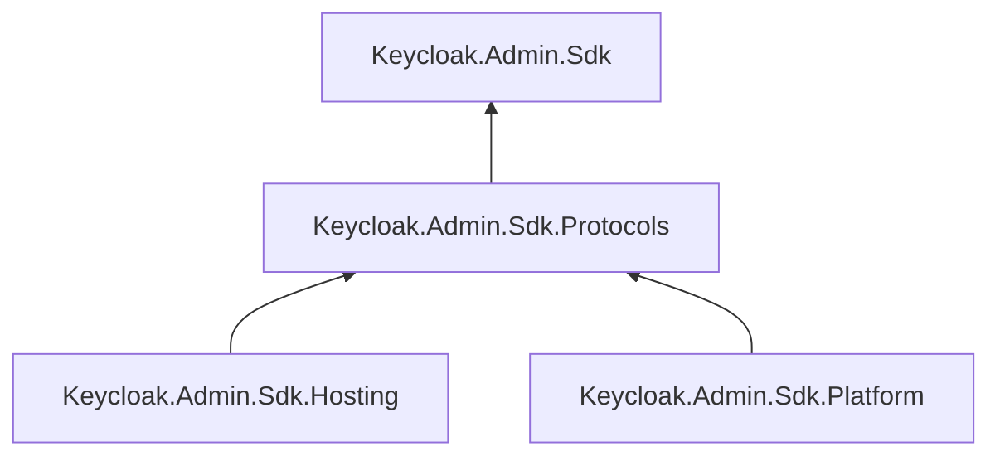

# preview.3 工程结构 / Project structure

本次整理保留四个生产工程和四个 NuGet 包。新增的测试工程均为 `IsPackable=false`，不会增加用户安装的包数。

箭头表示项目引用。Core 提供管理 API、模型、认证、HTTP 和能力策略；Protocols 提供应用协议和传输；Hosting 提供 ASP.NET Core 与 SAML 宿主集成；Platform 提供统一开关、微软 FeatureManagement 适配及默认关闭的 Application Insights 遥测。Hosting 与 Platform 通过宿主传入的受控协议传输协作，彼此没有项目引用。

Core、Protocols 保持 Native AOT 支持；Hosting、Platform 声明 Managed 支持。可选遥测是运行时启用选项，官方微软依赖仍是 Platform 包的 NuGet 依赖。

## 解决方案分组

| 分组 | 工程 | 职责 |
| --- | --- | --- |
| `src` | 四个生产工程 | 四个可独立消费的发布包 |
| `tests/Unit` | Core、Protocols、Hosting、Platform 四个测试工程 | 对应生产包的契约与单元覆盖率 |
| `tests/Integration` | IntegrationTests | Managed / Linux Native AOT 真实 Keycloak 验收程序 |
| `tests/Integration` | Engineering.Tests | 证据晋升、防伪、指纹、取消及子进程等工具测试 |
| `tests/PackageConsumption` | AotSmoke | 从候选 NuGet 还原 Core、Protocols，实际原生发布和执行 |
| `tests/PackageConsumption` | PackageSmoke | 从候选 NuGet 还原 Hosting、Platform，验证依赖图和默认关闭遥测 |
| `tools` | Generator | 生成管理 API 和模型，独立审计继续使用另一套扫描算法 |

共 13 个解决方案工程，其中可打包工程仍为 4 个。解决方案文件夹只调整 IDE 展示；现有真实验收和包消费命令路径保持稳定。

## 共享代码与依赖约束

- `tests/Directory.Build.props` 统一 MSTest、Coverlet 版本，并禁止测试工程打包。
- `tests/Shared/CoreContracts.props` 显式列出托管核心测试与 AotSmoke 共用的断言，手写源码放在 `tests/Shared/Contracts`；生成矩阵仍由生成器维护原有输出位置。
- `tests/Shared/Fixtures` 只保存可复用测试数据。Platform 测试不再依赖完整核心断言集。
- 核心单元测试只引用 Core；Protocols 单元测试只引用 Protocols；Platform、Hosting 各有独立测试。工程工具测试集中在 Engineering.Tests，核心测试不再引用真实验收可执行程序。
- `tools/Shared` 集中脚本的路径、取消、进程和目标基线支持。文件式命令入口保持原位，生成与审计算法不合并。

## 验证与发布

`Verify.cs` 依次验证生成一致性、五个 MSTest 测试工程、四个生产包的依赖清单、Managed 包消费与可选的原生包消费。Core、Protocols、Platform、Hosting 分别输出覆盖率报告；Hosting 与 Platform 的自有源码方法、行和分支覆盖率门槛均为 100%；第三方实现与 `obj/` 生成代码不包含在该口径中。

源码指纹覆盖全部 `src`、`tests`、`tools` 中相关源码、项目、共享构建属性与 JSON 配置，并包含解决方案文件。Docker 构建复制整个测试和工具目录，因此包含新共享文件和测试构建属性。调整这些输入后，旧证据会失效，需要重新运行真实验收。

完整发布候选使用 `dotnet run --file tools/Release.cs -- --bootstrap`。该命令只生成验证通过的本地候选、清单和包哈希；NuGet 上传由维护者执行。详细步骤见 [手动上传清单](releases/26.8.1-preview.3/manual-upload-checklist.md)。

## English change notes

The four shipping packages retain their existing responsibility and dependency boundaries. Platform tests and engineering acceptance tests now have dedicated projects. Shared AOT-safe assertions and tool infrastructure have explicit locations; MSTest and Coverlet versions are centralized. Both package-consumption projects are visible in the solution, and Platform and Hosting have independent coverage gates. Input fingerprints include the new shared sources and build imports, so fresh live acceptance is required before publishing preview.3.

Hosting now has 35 tests and mandatory 100% source method, line and branch coverage gates. Post-signature SAML validators are independently testable, and OIDC assurance reuses the exact bound token claims across asynchronous session lookup. The shipping package count remains four.
